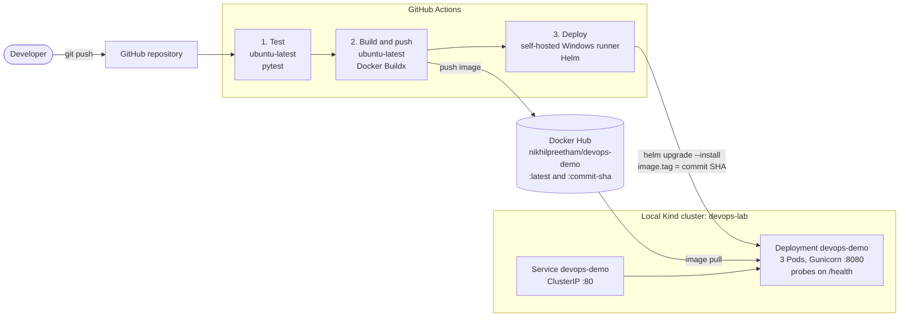

# Kubernetes CI/CD Application Deployment

A self-directed DevOps project that tests, containerizes and deploys a Python Flask application to a local Kubernetes cluster. GitHub Actions runs the tests, builds and pushes a Docker image to Docker Hub, and then deploys it with Helm to a Kind cluster through a self-hosted Windows runner.


---

## Table of Contents

1. [Project Objectives](#1-project-objectives)
2. [Architecture](#2-architecture)
3. [Technology Stack](#3-technology-stack)
4. [Repository Structure](#4-repository-structure)
5. [Application](#5-application)
6. [CI/CD Pipeline](#6-cicd-pipeline)
7. [Kubernetes and Helm Configuration](#7-kubernetes-and-helm-configuration)
8. [Local Setup](#8-local-setup)
9. [Operations Commands](#9-operations-commands)
10. [Troubleshooting and Recovery Exercises](#10-troubleshooting-and-recovery-exercises)
11. [Security Considerations](#11-security-considerations)
12. [Learning Outcomes](#12-learning-outcomes)
13. [Scope and Limitations](#13-scope-and-limitations)
14. [Future Improvements](#14-future-improvements)
15. [License](#15-license)

Additional documentation:

- [docs/implementation.md](docs/implementation.md): how each file connects, pipeline job details, image tagging
- [docs/troubleshooting.md](docs/troubleshooting.md): failure simulations, the Helm field ownership conflict, common errors
- [screenshots/README.md](screenshots/README.md): evidence screenshots to add

---

## 1. Project Objectives

- Build and test a Python Flask application.
- Containerize the application with Docker.
- Automate testing, image building and publishing with GitHub Actions.
- Deploy to Kubernetes with Helm, using the image built for each commit.
- Configure readiness and liveness probes.
- Practice rolling updates and Helm rollback.
- Simulate a health-check failure and recover from it.

## 2. Architecture



The test and build jobs run on GitHub-hosted Ubuntu runners. Only the deploy job runs on the self-hosted Windows runner, because that machine has access to the local Kind cluster.

## 3. Technology Stack

| Category | Technology |
|---|---|
| Application | Python, Flask |
| Application server | Gunicorn |
| Testing | Pytest |
| Containerization | Docker |
| Container registry | Docker Hub |
| CI/CD | GitHub Actions |
| Deploy runner | Self-hosted Windows runner |
| Orchestration | Kubernetes (Kind, local) |
| Deployment management | Helm |
| Development environment | Windows, PowerShell, Docker Desktop |

## 4. Repository Structure

```text
kubernetes-cicd-app/
├── README.md
├── LICENSE
├── .gitignore
├── .github/
│   └── workflows/
│       └── ci-cd.yml               # Test, build/push, deploy
├── app/
│   ├── app.py                      # Flask application (/ and /health)
│   ├── Dockerfile                  # Image definition (Gunicorn on 8080, non-root user)
│   └── requirements.txt            # Flask, Gunicorn
├── tests/
│   └── test_app.py                 # Pytest tests for both endpoints
├── helm/
│   └── devops-demo/                # Helm chart used by the pipeline
│       ├── Chart.yaml
│       ├── values.yaml
│       └── templates/
│           ├── deployment.yaml
│           └── service.yaml
├── k8s/
│   └── application.yaml            # Plain manifest from the manual stage (reference)
├── architecture/
│   └── architecture.mmd            # Editable Mermaid diagram
├── docs/
│   ├── implementation.md
│   └── troubleshooting.md
└── screenshots/
    └── README.md
```

The `actions-runner/` folder (the local runner installation and its credentials) is excluded by `.gitignore` and is never committed.

**About `k8s/application.yaml`:** this plain manifest (Namespace, Deployment with 2 replicas, Service) is from the stage before Helm, when a locally built `devops-demo:1.0.0` image was deployed with `kubectl apply`. The pipeline does not use it; Helm is the deployment method. It is kept as a reference for comparing raw manifests with the Helm chart. Do not apply it to the same namespace as the Helm release, because both create a Deployment and a Service named `devops-demo`.

## 5. Application

| Endpoint | Response | Used by |
|---|---|---|
| `/` | JSON message and a UTC timestamp | Users |
| `/health` | `{"status": "healthy"}` with HTTP 200 | Readiness and liveness probes |

The container runs Gunicorn with 2 workers on port `8080`, as a non-root user (`appuser`).

## 6. CI/CD Pipeline

Workflow: [`.github/workflows/ci-cd.yml`](.github/workflows/ci-cd.yml). It runs on pushes and pull requests to `main`.

| Job | Runs on | When | What it does |
|---|---|---|---|
| `test` | `ubuntu-latest` | Every push and PR | Installs dependencies and runs `pytest` |
| `docker` | `ubuntu-latest` | After `test` passes | Builds the image; on pushes to `main` only, logs in to Docker Hub and pushes `:latest` and `:<commit-sha>` |
| `deploy` | `self-hosted` (Windows) | After `docker`, pushes to `main` only | `kubectl cluster-info`, `helm upgrade --install` with `image.tag=<commit-sha>`, then `kubectl rollout status` |

**Why the commit SHA tag:** every deployment points to the exact image built from that commit, so a rollout or rollback always runs a known version. `latest` is pushed for convenience but is not used for deployment.

**Required repository secrets:** `DOCKERHUB_USERNAME`, `DOCKERHUB_TOKEN` (a Docker Hub access token, not the account password).

The self-hosted runner must be online, and the Kind cluster must be running, for the deploy job to succeed.

## 7. Kubernetes and Helm Configuration

| Setting | Value |
|---|---|
| Cluster / context | `devops-lab` / `kind-devops-lab` |
| Namespace | `devops-demo` |
| Helm release, Deployment, Service | `devops-demo` |
| Replicas | 3 |
| Service | `ClusterIP`, port 80, target port `http` (8080) |
| Readiness probe | `GET /health`, initial delay 3 s, every 5 s |
| Liveness probe | `GET /health`, initial delay 10 s, every 10 s |
| CPU | request `50m`, limit `250m` |
| Memory | request `64Mi`, limit `128Mi` |

**Readiness vs liveness:** when readiness fails, the Pod is removed from the Service's endpoints and receives no traffic, but it is not restarted. When liveness fails repeatedly, the kubelet restarts the container.

## 8. Local Setup

### Prerequisites

Git, Docker Desktop, kubectl, Kind, Helm, Python, a Docker Hub account, and (for the pipeline's deploy job) a self-hosted GitHub Actions runner on the machine running Kind.

### Clone and test

```powershell
git clone https://github.com/nikhilpreetham/kubernetes-cicd-app.git
cd kubernetes-cicd-app
python -m pip install -r app/requirements.txt pytest
python -m pytest tests/ -v
```

### Create the Kind cluster

```powershell
kind create cluster --name devops-lab
kubectl config current-context
kubectl get nodes
```

### Deploy with Helm

Replace `<IMAGE_TAG>` with a tag that exists in Docker Hub (a commit SHA):

```powershell
helm upgrade --install devops-demo ./helm/devops-demo `
  --namespace devops-demo `
  --create-namespace `
  --set image.repository=nikhilpreetham/devops-demo `
  --set image.tag=<IMAGE_TAG> `
  --wait `
  --timeout 5m
```

```powershell
kubectl get pods -n devops-demo
helm status devops-demo -n devops-demo
```

### Open the application

```powershell
kubectl port-forward svc/devops-demo 8080:80 -n devops-demo
```

Then open `http://localhost:8080` and `http://localhost:8080/health`.

## 9. Operations Commands

```powershell
# Cluster and namespace
kubectl cluster-info
kubectl get all -n devops-demo

# Deployment and Pods
kubectl get deployment devops-demo -n devops-demo
kubectl get pods -n devops-demo
kubectl describe pod <POD_NAME> -n devops-demo
kubectl logs -l app.kubernetes.io/instance=devops-demo -n devops-demo

# Rollout
kubectl rollout status deployment/devops-demo -n devops-demo
kubectl rollout history deployment/devops-demo -n devops-demo

# Helm release
helm list -n devops-demo
helm status devops-demo -n devops-demo
helm history devops-demo -n devops-demo
helm rollback devops-demo <REVISION> -n devops-demo --wait
```

## 10. Troubleshooting and Recovery Exercises

These exercises were performed on the local cluster. Full details are in [docs/troubleshooting.md](docs/troubleshooting.md).

| # | Exercise | Result |
|---|---|---|
| 1 | Rolling updates through Helm | Deployed new image versions with Helm and followed the rollout with `kubectl rollout status` |
| 2 | Helm rollback | Reviewed `helm history` and rolled back to an earlier revision with `helm rollback` |
| 3 | Liveness probe failure | Changed the liveness path to `/invalid-health`; Kubernetes restarted the containers (all 3 Pods showed 2 restarts); restored `/health` |
| 4 | Helm field ownership conflict | A manual `kubectl patch` made `kubectl-patch` the owner of Deployment fields; the next Helm upgrade conflicted; resolved with `--force-conflicts` |
| 5 | Pipeline deploy failure | `templates/service.yaml` had accidentally been filled with `.gitignore` content, so the Helm deploy step failed; the real Service template was restored in commit `0e0932f`, and the next run passed |

**State verified after recovery:** 3 of 3 replicas available, 3 Pods running, 0 restarts, both probes on `/health`, Helm release revision 8 with status `deployed`. This is the state observed at the end of the exercise, not a description of the cluster today.

## 11. Security Considerations

- Docker Hub credentials are stored as GitHub repository secrets and are never written to files or logs.
- Images are pushed only from `main`; pull requests build the image without pushing it.
- The container runs as a non-root user.
- The workflow token is limited to `contents: read`.
- The self-hosted runner's installation folder and credentials are excluded from Git.
- **Self-hosted runner on a public repository:** GitHub advises against using self-hosted runners with public repositories, because a workflow change in a fork pull request could run code on the runner machine. This repository requires maintainer approval before workflows from outside contributors run (**Settings > Actions > General > Approval for running fork pull request workflows > Require approval for all external contributors**). A safer long-term option is listed in [Future Improvements](#14-future-improvements).

## 12. Learning Outcomes

- Writing and testing a small Flask service with Pytest.
- Writing a Dockerfile that runs as a non-root user, and publishing images to Docker Hub.
- Splitting a pipeline into test, build and deploy jobs, with deployment limited to `main`.
- Managing GitHub Actions secrets and running a self-hosted runner for local deployment.
- Packaging Kubernetes resources as a Helm chart and deploying with commit-SHA image tags.
- The difference between readiness and liveness probes, shown by a deliberate failure.
- Rolling updates, Helm rollback, and Helm field ownership conflicts.

## 13. Scope and Limitations

- **Local learning environment.** The cluster is a single-node Kind cluster on a Windows PC, not a production or managed Kubernetes service.
- **Deployment depends on one machine.** If the PC, the runner or the cluster is off, the deploy job waits for a runner and the pipeline does not complete.
- **No external access.** The Service is `ClusterIP`; the application is reached with `kubectl port-forward`.
- **No monitoring or alerting** beyond Kubernetes probes and `kubectl` commands.
- **Windows-specific deploy step.** The Helm command uses PowerShell line continuations.
- **No pod security context** in the Helm chart; non-root execution comes from the Dockerfile.

## 14. Future Improvements

- Replace the self-hosted runner with a pull-based deployment (for example Argo CD running inside the cluster), so no runner is attached to a public repository.
- Add a `securityContext` (`runAsNonRoot`, `allowPrivilegeEscalation: false`, `readOnlyRootFilesystem`) to the chart.
- Add `helm lint` and a container image scan (for example Trivy) to the pipeline.
- Add an Ingress so the application is reachable without port-forwarding.
- Deploy to a managed cluster such as Amazon EKS.

## 15. License

This project is licensed under the [MIT License](LICENSE).

---

*Self-directed DevOps learning project. Docker Hub image: [nikhilpreetham/devops-demo](https://hub.docker.com/r/nikhilpreetham/devops-demo).*
